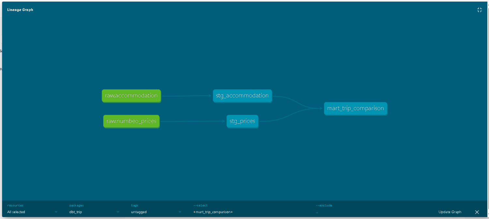

# Technical Architecture & Engineering Specs

This document covers the technical implementation of the ELT pipeline powering the Trip Cost Analyzer.

## Tech Stack
* **Ingestion & Parsing:** Python 3.11 (`requests`, `BeautifulSoup4`, `re`, `pandas`)
* **Data Warehouse:** Google BigQuery (`EU` multi-region)
* **Transformation & Testing:** `dbt Core` (v1.12) + `dbt-bigquery`
* **Visualization:** Microsoft Power BI Desktop (DAX, What-If Parameters)

---

## Pipeline Stages (ELT)

### Stage 1: Extract & Load (`extract/`)
* **`test_scraper.py`**: Scrapes structured HTML price tables from Numbeo for Warsaw and Utrecht using `BeautifulSoup4`, extracts numeric values via regex, fetches live EUR/PLN exchange rates from `api.frankfurter.app`, and exports normalized CSV files.
* **`extract_accommodation.py`**: Queries the Airbnb search endpoint via RapidAPI with fixed trip dates (`2026-12-29` to `2027-01-02`), extracts nested JSON pricing structures, parses ratings, and exports 80 real listings (40 per city).
* **`load_to_bigquery.py`**: Authenticates via GCP Service Account, creates the `raw` dataset in BigQuery, appends audit metadata (`_loaded_at` UTC timestamp), and loads tables using `WRITE_TRUNCATE` with schema autodetection.

### Stage 2: Transform & Test (`dbt_trip/`)
Data transformations follow a two-layer dbt architecture:

1. **Staging Layer (`models/staging/`, materialized as Views):**
   * `stg_accommodation`: Filters null and outlier prices (`>= €50`), calculates unit metrics (`price_per_night`, `price_per_person_one_night`) with zero-division protection (`NULLIF`).
   * `stg_prices`: Standardizes consumer items into business categories (`food`, `nightlife`, `transport`) using case-insensitive regex matching (`REGEXP_CONTAINS`).
2. **Marts Layer (`models/marts/`, materialized as Tables):**
   * `mart_trip_comparison`: Joins staging models by `city`, aggregates average accommodation rates and daily spending baskets, and computes dynamic multi-day budgets using `trip_nights` from the source data.

**Data Quality & Lineage:**
* Automated schema tests in `marts.yml` enforce `not_null`, `unique`, and `accepted_values` constraints across key metrics.
* Interactive documentation and lineage graph generated via `dbt docs`.



### Stage 3: BI & Analytics Layer (`powerbi/`)
* Connects directly to `dbt_dev` tables in Google BigQuery.
* Implements dynamic What-If Parameters (`Group Size` 1-12, `Trip Nights` 1-14) and `CALCULATE`-based DAX measures for isolated city KPIs and group savings.
* Cross-filtering is explicitly managed (`Edit Interactions`) to keep top-level KPI cards isolated from chart drill-downs while remaining responsive to parameter sliders.

---

## Repository Structure
```text
├── extract/                 # Python scraping, API extraction & BigQuery loader
├── dbt_trip/                # dbt project (models/staging, models/marts, tests)
├── powerbi/                 # Power BI Desktop report (.pbix)
├── docs/                    # Architecture diagrams and dashboard screenshots
├── ARCHITECTURE.md          # Technical documentation
└── README.md                # Business overview & key insights
```
