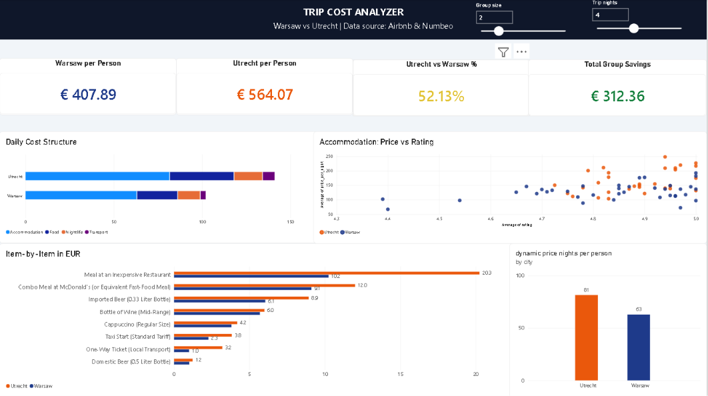

# Trip Cost Analyzer: Warsaw vs. Utrecht

An end-to-end analytics pipeline and interactive Power BI dashboard built to compare travel and living expenses between two European cities, originally created to plan a New Year's trip (Dec 29 - Jan 2).

## 1. Business Context & Problem
Planning a group trip requires looking beyond accommodation prices. Daily living costs, such as food, public transport, and nightlife, often make up 40-50% of the total budget.

This project compares **Warsaw (Poland)** and **Utrecht (Netherlands)** using live market prices and provides an interactive cost calculator where group size and trip duration adjust dynamically.

## 2. Key Analytical Findings (4 Nights, 2 Guests Baseline)
* **Total Budget per Person:** Warsaw costs **€407.89** vs. Utrecht **€564.07**.
* **Cost Advantage:** Utrecht is **38.3% more expensive** overall.
* **Daily Living Costs:** Food, transport, and nightlife cost **€39.19/day** in Warsaw compared to **€59.62/day** in Utrecht (+52%).
* **Group Impact:** Choosing Warsaw saves **€312** for 2 people or **€781** for a group of 5 people over 4 days.

**Recommendation:** Warsaw offers significantly better value for money, with higher-rated apartments available at lower nightly rates and much lower daily expenses.

## 3. How It Works (3-Stage Pipeline)
1. **Data Collection (Extract & Load):** Automated Python scripts fetch accommodation listings (Airbnb API), local consumer prices (Numbeo), and live exchange rates (ECB Frankfurter API), storing raw data in Google BigQuery.
2. **Data Modeling (Transform & Test):** `dbt Core` cleans raw data, converts currencies to EUR, builds analytical marts, and runs automated data quality tests (`not_null`, `unique`, `accepted_values`).
3. **Visualization (BI):** Power BI connects directly to BigQuery marts with DAX What-If parameters (`Group Size`, `Trip Nights`) for real-time scenario modeling.

> For technical implementation details, SQL architecture, and data lineage, see [ARCHITECTURE.md](ARCHITECTURE.md).
